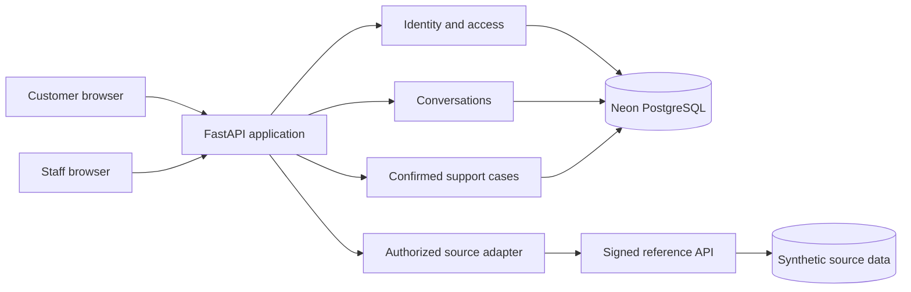

# Airport AI Assistant

A bilingual customer service workspace for airport passengers and support teams.

Airport AI Assistant brings airport guidance, authorized booking information, and customer
case handling into a clear support journey. Customers can explain an issue, review a request
before submitting it, and follow its resolution. Staff work within explicit organization,
queue, and role boundaries.

> From a passenger's question to a confirmed, traceable support case.

[Product walkthrough](guides/PRODUCT_TOUR.md) | [Engineering case study](guides/CASE_STUDY.md) | [Run locally](guides/GETTING_STARTED.md)


Westbridge Airport is a fictional demonstration brand. The image is original generated artwork;
the visual walkthrough uses synthetic scenarios.

## What the Product Does

- **Airport guidance:** English and Indonesian navigation for information, booking help,
  transaction questions, and contacting support.
- **Authorized source access:** read-only parking and lounge booking information, transaction
  projections, and the policy version associated with a booking.
- **Review before submission:** editable drafts and explicit customer confirmation before a
  support case is recorded.
- **Traceable case handling:** staff assignment, status changes, closure, and customer follow-up
  preserve the history of the same issue.
- **Scoped workspaces:** customer, customer service, supervisor, and administrator access is
  checked against tenant and resource ownership.

## Customer Journey

```text
Choose a help topic -> Explain the issue -> Verify contact
                   -> Review the request -> Confirm submission
                   -> Track the case -> Review the outcome or request further help
```

The [design walkthrough](guides/PRODUCT_TOUR.md) makes this journey inspectable without
credentials. Its static pages demonstrate interactions with local fixtures. The modular backend
separately implements identity, durable conversations, confirmed case submission, and case
lifecycle rules; the static preview does not submit real cases.

## Engineering Highlights

| Concern            | Implementation                                                                                                                                              |
| ------------------ | ----------------------------------------------------------------------------------------------------------------------------------------------------------- |
| Domain boundaries  | FastAPI routes, business services, persistence, and provider adapters have separate responsibilities; an executable import guard checks their dependencies. |
| Tenant isolation   | PostgreSQL row-level security, restricted runtime roles, tenant-aware keys, and transaction-local identity context.                                         |
| Identity           | Browser-bound email verification, session rotation, CSRF protection, and separate staff password authentication.                                            |
| Confirmed actions  | Session-bound drafts, canonical request hashes, explicit confirmation, and atomic case/history/audit/outbox records.                                        |
| Reliable retries   | Stable idempotency receipts and version checks protect conversations and case transitions from duplicate mutations.                                         |
| Source integration | A separate signed reference API, explicit resource grants, validated responses, and immutable security labels.                                              |
| Data handling      | Synthetic fixtures, redacted errors, controlled request identifiers, and ignored local credentials and artifacts.                                           |

## Architecture



The frontend uses React, TypeScript, and Vite. The backend uses Python, FastAPI, Psycopg, and
Alembic. Business logic stays in a modular application; the independent reference service
supplies fictional booking and transaction data through a read-only integration boundary.

See the [engineering case study](guides/CASE_STUDY.md) for the design decisions and
[architecture specification](ARCHITECTURE.md) for the broader system design.

## Explore Locally

Preview the customer journey with Python alone:

```powershell
git clone https://github.com/williamlo90/airport-ai-assistant.git
cd airport-ai-assistant
python -m http.server 4173 --bind 127.0.0.1 --directory frontend/prototype
```

Open [the local design preview](http://127.0.0.1:4173). Stop the server with Ctrl+C.

For the React application, API bootstrap, and reference-service setup, follow
[Getting started](guides/GETTING_STARTED.md). Dependency lockfiles accompany each application.

## Review and Verification

The repository includes backend unit and domain-boundary tests, opt-in PostgreSQL integration
tests, reference-service tests, and frontend component tests. Review instructions distinguish
the credential-free path from database-connected verification.

The [quality gate](.github/workflows/quality-gate.yml) checks repository documentation on pull
requests or manual dispatch. Credential-free application checks are an explicit manual option.
Tests execute in a bounded sequence; local resource rules are documented in the
[verification guide](guides/VERIFICATION.md).

## Documentation

| Read                                                | Purpose                                                                |
| --------------------------------------------------- | ---------------------------------------------------------------------- |
| [Guide index](guides/README.md)                     | Find product, engineering, and setup material.                         |
| [Product tour](guides/PRODUCT_TOUR.md)              | Inspect the customer journey using the static preview.                 |
| [Engineering case study](guides/CASE_STUDY.md)      | Understand domain boundaries, security, and reliable case transitions. |
| [Getting started](guides/GETTING_STARTED.md)        | Run the preview and application components.                            |
| [Verification](guides/VERIFICATION.md)              | Run appropriate checks without paid services.                          |
| [Product contract](PRODUCT_CONTRACT.md)             | Product scope and business rules.                                      |
| [Architecture](ARCHITECTURE.md)                     | Detailed system design and integration direction.                      |
| [Data and API contracts](DATA_AND_API_CONTRACTS.md) | Data ownership, confirmation, and state transitions.                   |
| [Test plan](TEST_PLAN.md)                           | Verification scenarios and acceptance requirements.                    |

The product and architecture contracts describe both implemented behavior and planned
capabilities. AI orchestration, live staff handoff, and email delivery belong to the broader
design; the preview uses local scripted responses. Source integration uses fictional data.
Booking creation, payment processing, and refund execution are outside the product scope.

## Source Use

Copyright (c) 2026 williamlo90. All rights reserved. This repository is available for portfolio
review; the [source-use notice](LICENSE) does not grant permission to reuse, modify, or
redistribute the original source code. Third-party assets retain their own terms.
