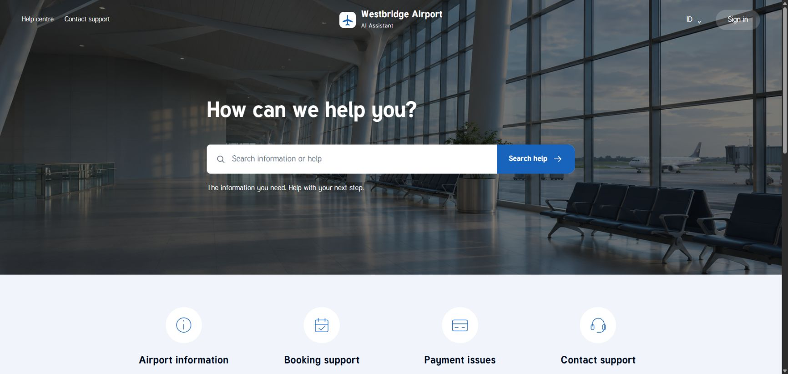
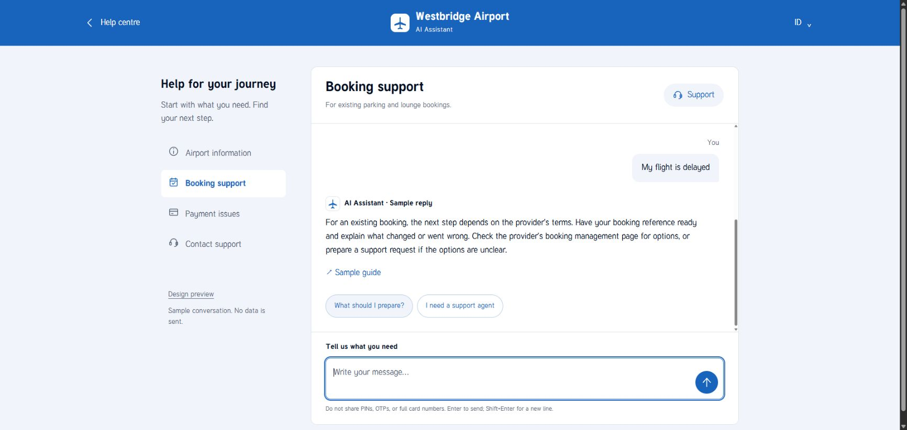
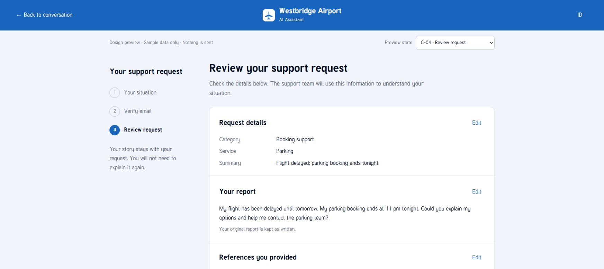
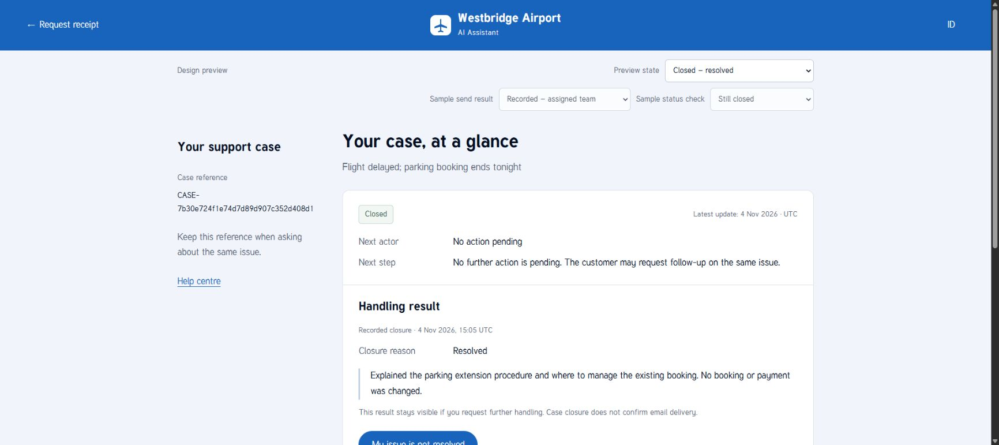

# Product tour

[Project overview](../README.md) · [Run locally](GETTING_STARTED.md)

## Find the right help

The homepage brings search, service categories, and help guides together. Customers can start
with airport information, booking support, payment issues, or a support conversation.



## Explain the issue

Guided clarification keeps the conversation focused on the customer's situation. Original
messages stay in their chosen language while the interface can switch between English and
Indonesian.



## Review before sending

The request review organizes the service, report, booking references, contact details, and
receiving team before the customer confirms submission.



## Follow the outcome

The case screen brings together status, next steps, and the handling result. Customers can
inspect history or ask for further help with the same issue.



## Open the preview

From the repository root:

```powershell
python -m http.server 4173 --bind 127.0.0.1 --directory frontend/prototype
```

| Screen               | Open locally                                                             |
| -------------------- | ------------------------------------------------------------------------ |
| Homepage             | [Help centre](http://127.0.0.1:4173/)                                    |
| Conversation         | [Booking support](http://127.0.0.1:4173/conversation.html?topic=booking) |
| Contact verification | [Verify email](http://127.0.0.1:4173/request.html?step=verify)           |
| Request review       | [Review request](http://127.0.0.1:4173/request.html?step=review)         |
| Submission           | [Request receipt](http://127.0.0.1:4173/submission.html)                 |
| Case details         | [Case follow-up](http://127.0.0.1:4173/case.html?preview=closed)         |

The screenshots were captured from the customer preview in `frontend/prototype/`.
Stop the server with Ctrl+C.
